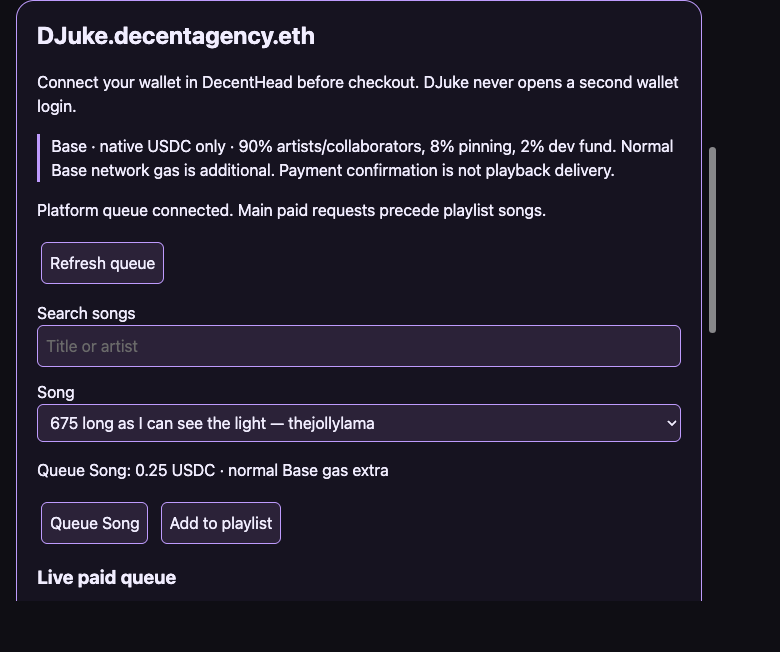
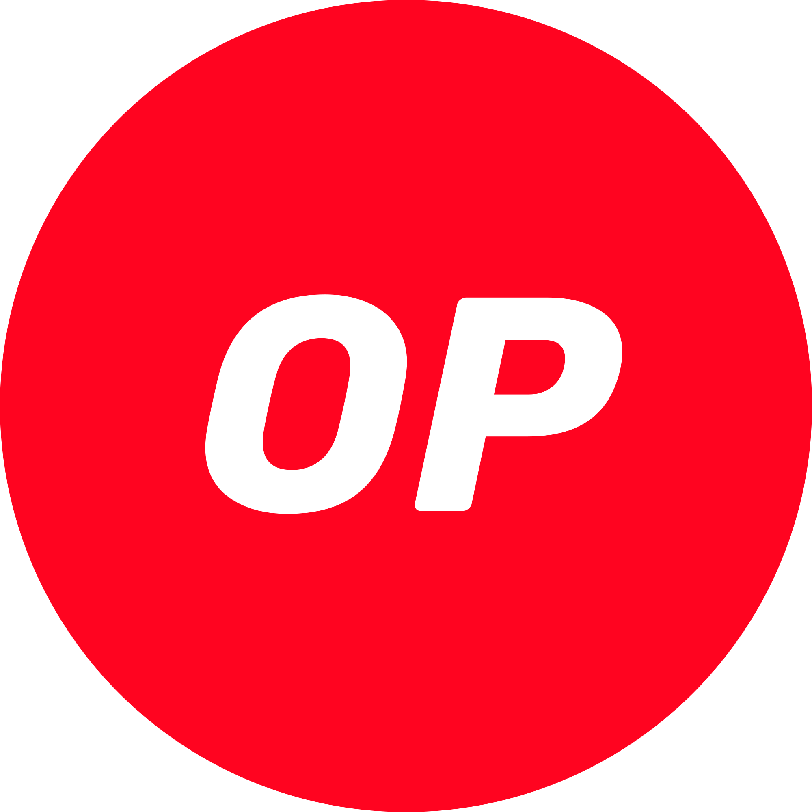

# DJuke — cloneable jukebox widget

**Display identity: DJuke.decentagency.eth** · normalized ENS/DNS:
`djuke.decentagency.eth`. This label is not a claim of ENS registration,
contenthash/DNS deployment, minted editions or a published release.

A real plain-ES-module paid jukebox product, not a full-site iframe or mock.
Includes singles/replacement, ordered playlist drafts, Save to Profile,
Personal Play, Play Live and receipts/recovery under Profile → Playlists.
Supporter release inputs are **unminted, unsigned drafts**:
[release checklist](docs/SUPPORTER-RELEASE.md), [parameters](docs/supporter-release-inputs.json),
[draft metadata](docs/supporter-metadata.draft.json).



## Clone and preview

```sh
git clone https://github.com/A-Decent-Agency/DecentJukebox.git
cd DecentJukebox
# Check out the reviewed PR/commit while this work is unmerged.
node scripts/vendor-busking.mjs --check
node --test test/*.test.cjs
python3 -m http.server 8793 --bind 127.0.0.1
# Open http://127.0.0.1:8793/widget.html
```

No install/build is needed to serve the committed widget. Existing `public/`
is preserved **historical Jukebox prior art**; the new entry is `widget.html`,
not that legacy Polygon/MintMe application. The legacy root dependencies are
not a worker deployment. Do not enter wallet secrets or IPFS credentials in
configuration or source.

The demo loads DecentHead v2 from immutable commit
`072a5206489d0e4a3f2576c56f8debb729d933c9` and ethers v6.17.0 via CDN.
Use your existing host's copy instead in an integration (one header only).
CDN unavailability/CSP must be handled by your host or a separately reviewed
local dependency copy; no private credentials are involved.

## Embed: S12 host contract

```html
<!-- Your host already owns a single <decent-header>. -->
<div id="music" style="--djuke-accent:#99e9ce;--djuke-radius:8px"></div>
<script type="module">
  import { mount } from './widget.js';
  const widget = mount(document.getElementById('music'), {
    title: 'Our community DJuke',
    ethers: window.ethers, // host-supplied ethers v6
    config: {
      ipfsUploadServiceUrl: 'https://decentbusking.onrender.com',
      djukeContractAddress: '0xf51D2F7892cF9D49e14DF4afDf227a59ee170A51',
      djukeContractVersion: '0.5',
      djukePlaylistBatchAddress: '0xf51D2F7892cF9D49e14DF4afDf227a59ee170A51',
      djukePlaylistBatchVersion: '0.5',
      djukePlaylistBatchEnabled: true,
      djukePlaylistRadioReady: true
    }
  });
  // On SPA route disposal, not after each render:
  // widget.destroy(); // idempotent, and the same element may be mounted again
</script>
```

Options never overwrite host configuration. DJuke waits for
`window.DecentHead` / `decenthead:ready`, reads `getWallet().snapshot()`, uses
the **existing connected ethers BrowserProvider**, and unsubscribes from
`head.on('wallet')` at teardown. It never calls `wallet.connect()`,
`eth_requestAccounts`, or `ensureChain`; connect and switch to **Base** using
the host header first. Signer retrieval is only on an explicit user action,
not mount. Save/copy requires an explicit wallet authorization; checkout
requires real approvals/transactions only when the user deliberately chooses it.

It reuses `getIpfs()` rather than creating a storage login. That host session
is not a raw audio uploader; DJuke never uploads or pins. `ipfsGateway`
option defaults to `https://ipfs.io/ipfs/` for paid media. A gateway URL is not
durable pinning. `head`, `fetch`, `storage`, and `ethers` injection support
deterministic tests. `refresh()` is also returned. Destroy aborts pending
fetches and cancels later approval/send after async preparation, clears timers,
listeners and media, and persists active Personal Play progress. An already
submitted wallet transaction cannot be reversed by unmounting; keep its receipt.

## Customize without removing principal controls

Set inherited CSS variables on the mount element:
`--djuke-background`, `--djuke-text`, `--djuke-accent`, `--djuke-control`,
`--djuke-font`, `--djuke-radius`, `--djuke-width`. Shadow DOM prevents CSS
leakage. Reduced-motion preferences, keyboard focus, native audio controls
and status announcements remain accessible. Change title/colors/font/spacing;
keep core song/playlist/receipt controls, prices, artist/fund split and
transaction/delivery distinctions visible.

## Real platform services, support and funding

The static clone does **not** self-host contracts or a funded playback worker.
Its explicit default configuration is the current DecentBusking Base DJuke
v0.5 contract `0xf51D2F7892cF9D49e14DF4afDf227a59ee170A51` and
`https://decentbusking.onrender.com`. Only native Base USDC
`0x833589fCD6eDb6E08f4c7C32D4f71b54bdA02913` is accepted. The public
service may be offline, and clone origins must be approved for CORS and
signed-profile mutations. Do not claim successful integration until your
exact host origin has been permitted and staging-tested.

Checkout is disabled with explicit errors if config, the worker, contract
identity or playlist readiness is missing/mismatched. Queue confirmation
is not delivery. Worker funding, durable mirror/checkpoints, media retries,
per-resource EOF/PCM evidence, partial refunds, milestone fees and settlement
remain the platform's responsibilities; no worker code is copied here.
The frozen source is newer than #274's media evidence fix. Private purchases
save recovery before confirmation, verify transaction ownership on resume
and never repurchase on Resume. Keep browser storage and your Base receipt.

Single payments preserve **90% artists/collaborators, 8% pinning, 2% dev fund**.
Play Live playlist fees remain 3 USDC per started group of 12 songs; normal
Base network gas is separate, not a new listener worker-ETH charge.
Supporter editions support maintenance/infrastructure, not investment yield,
music ownership or an unlimited service guarantee.

For support, open an issue here with browser/version, public service/contract,
error, affected playlist/lane and transaction hash. Platform incidents also
belong in [DecentBusking](https://github.com/TheJollyLaMa/DecentBusking/issues).
Never submit secrets, wallet recovery phrases or private profile exports.

## Provenance and validation

`vendor/busking/` is a narrow, byte-preserved snapshot at
[`aa851edda6d3aa08711c66d8e7c480dedca98533`](https://github.com/TheJollyLaMa/DecentBusking/commit/aa851edda6d3aa08711c66d8e7c480dedca98533),
not a moving URL or whole-app copy. Manifest: `sources/busking.json`;
hashes: `vendor/busking/INVENTORY.json`. Code is Apache-2.0, original
creative content CC BY 4.0; upstream LICENSE/NOTICE/creative license
are preserved. Screenshot provenance: [ARTWORK-PROVENANCE](docs/ARTWORK-PROVENANCE.md).

To update, review an immutable upstream commit, edit the source manifest,
then run `node scripts/vendor-busking.mjs --refresh /path/to/DecentBusking`.
Never hand-edit vendored files. `--check` validates exact file/hash inventory.
The native tests exercise actual mount/destroy and synthetic single/replacement/
save/private/recovery/live handlers; no test signs or sends real transactions.
Upstream ran 98 DJuke/audio-evidence tests, including #274 EOF/PCM and retry
regressions. No live paid test, mint, pin, registration, listing, tag,
release, announcement or production restart was performed.

---

## Historical Jukebox prior art and credits (preserved)

The legacy material below documents the earlier application, not the current
standalone widget configuration or a claim that it runs on Polygon/MintMe.

<div  style="font-family: 'Comic Sans MS', cursive; font-size: 24px; color: white; background-color: black; padding: 10px;" align="center">
    
    
    
</div>

<div align="center">
    
    <h1>🎵 Decent JukeBox 🎵</h1>
</div>


<div align="center">
    	
</div>

<div>
    <p>
    This ain't your Grandma's Jukebox! Check out the <a href="https://thejollylama.github.io/JollyJukeBox/public/" target="_blank">Decent JukeBox </a> to play around with some tunes and see what's possible with Web3!</p>
    <p>While you're listening, come join the community and get on the books at <a href="https://www.mintme.com/token/DecentJukebox">Decent Jukebox on MintMe</a>.</p>
    <p>
    🎶🎶 Enjoy the tunes! 🎶🎶
    </p>
</div>
<div>
    <h2>Credits:</h2>
    <p>BOBDUB - for the render request and brainstorm sessions.
    <br>
    <a href="https://www.mintme.com/token/bobdubbloon" target="_blank"> BobDub on MintMe </a> </p>
    <p>MTCG - for the ecosystem of Web3 friends to watch learn and grow together. while apart.
    <br>
    <a href="https://www.mintme.com/token/mtcg"  > MTCG on MintMe </a> </p>
    <p><a href="https://innovationassets.gumroad.com/?recommended_by=library&_gl=1*e3bpgc*_ga*MTA0MTE3Nzg4NC4xNzMyMjkwNzEw*_ga_6LJN6D94N6*MTczMjI5MDcxMC4xLjEuMTczMjI5MDcyMC4wLjAuMA.." target="_blank"> JukeBox Creator on Gumroad </a> - for the sweet 3d model to put our own blender render remix onto. 
    </p>
    <br>
    <p>
        This project brought to you by Decent Agency in collaboration with Decent Production and Decent Smart Homes. Decent JukeBox is one of the many ways to play around with the increased agency inherent in Web3 - after the work is done and home is in codified order, of course.
        <br>
        <a href="https://www.mintme.com/token/DecentSmartHomes" target="_blank">Decent Smart Homes on MintMe</a>
    </p>
</div>


# Metamask
<div>
    
    <p>
    MetaMask is a software cryptocurrency wallet used to interact with the Ethereum blockchain. It allows users to access their Ethereum wallet through a browser extension or mobile app, which can then be used to interact with decentralized applications (dApps) on the web.
    </p>
    <p>
    MetaMask also allows users to store and manage account keys, broadcast transactions, send and receive cryptocurrencies, and securely connect to decentralized applications through a compatible web browser or mobile app.
    </p>
    <p>Decent Jukebox currently opperates on the Polygon and Mintme chains. Chain information can always be found and verified at <a href="https://chainlist.org/" target="_blank">Chainlist.org</a> to ensure your metamask is connected to the proper endpoints.</p>
    
</div>

# IPFS and Web3.Storage
<div>
    
    
    <p>
    IPFS (InterPlanetary File System) is a protocol and network designed to create a content-addressable, peer-to-peer method of storing and sharing hypermedia in a distributed file system. IPFS was initially designed by Juan Benet, and is now an open-source project developed with help from the community.
    </p>
    <p>
    Web3.Storage is a service that makes it easy to store and retrieve data on the IPFS network. It provides a simple API that allows developers to store and retrieve data without having to run their own IPFS node. Web3.Storage is built on top of the IPFS network, and provides a reliable and scalable way to store and retrieve data on IPFS.
    </p>
    <p>
    Decent JukeBox uses IPFS and Web3.Storage to store and retrieve the music files that are played on the platform. This allows users to access the music files from anywhere in the world, without having to rely on a centralized server.
    </p>
   <h2> Keep your Data DECENT! <h2>
</div>

# Web3 and Decentralized Web
<div>
    <!-- link to web3 video on youtube -->
    <a href="https://www.youtube.com/watch?v=nHhAEkG1y2U" target="_blank">
        What is  ?
    </a>
    <p>
    Web3 is a term used to describe the next generation of the internet, which is built on decentralized technologies such as blockchain and smart contracts. Web3 aims to create a more open, secure, and user-centric web that empowers individuals and removes the need for intermediaries.
    </p>
    <p>
    Decentralized web technologies such as IPFS, Ethereum, and smart contracts are key components of Web3. These technologies enable users to interact with applications and services in a peer-to-peer manner. Decent Jukebox is an examplary use of the Web3 technologies being explored and developed by the Decent Agency for use in The Decent Smart Home algorithms.
    </p>
</div>

# Relevant Contracts and Git repos to the Project
<a href="https://eclipsingbinary.github.io/ECLIPSEJukeBox/public/" target="_blank">Eclipse's Jukebox (V1.2.3 on Polygon)</a>
[Decent JukeBox V1.2.3 on Polygon](https://polygonscan.com/address/0xbD01c10490BA3E99bCf7ab4B06dDa3A80B79AC7C)

<a href="https://bobdub.github.io/JollyJukeBox/public/" target="_blank">Bobdub's Jukebox (V1.2.2 on Polygon)</a>
[Decent JukeBox V1.2.2 on Polygon](https://polygonscan.com/address/0x48c33Eb5843a6A84AB01f7d456F4Fd61EB1c3c92)


[Decent JukeBox V1.2.6 on Optimism](https://optimistic.etherscan.io/address/0xbDDeF5dcf7DdedB400D982E35c6627f89E85D4BE) (update Play Fees)

[Decent JukeBox V1.2.5 on Optimism](https://optimistic.etherscan.io/address/0x1e1858938dCFdB4264F8201eF85b2fEf9CD170Ad)

[Decent JukeBox V1.2.4 on Optimism](https://optimistic.etherscan.io/address/0xB789986181C864d16e89931E6520d8CeC159b152)

[Decent JukeBox V1.2 on Polygon](https://polygonscan.com/address/0xACB7850f5836fD9981c7d01F2Ca64628a661f287) (Split Owner)

[Decent JukeBox V1.2 on MintMe](https://www.mintme.com/explorer/addr/0x95f35eb32feaa8dd025bbf1aaec157091cca6dd2)

[Decent JukeBox V1.1 on Polygon](https://polygonscan.com/address/0x180Cf8CB681a083A73c997809FF60Df857010bF9)


[SmartHome Test Token on Polygon](https://polygonscan.com/address/0x81cCeF6414D4CDbed9FD6Ea98c2D00105800cd78)

[SmartHome Test Token on Optimism](https://optimistic.etherscan.io/address/0xDb83f6d02a9fA73fc1B47A0Cfff33D2dC66aD619)


[GloDollar on Optimism](https://optimistic.etherscan.io/token/0x4F604735c1cF31399C6E711D5962b2B3E0225AD3)


## 📞 Contact

If you have any questions or suggestions, feel free to reach out to us at [jollysimsiddhi@gmail.com](mailto:jollysimsiddhi@gmail.com).

_________________________🦟________________________________________________________🕷️____

🪲 Found a bug? 🦟 [Open an issue](https://github.com/TheJollyLaMa/JollyJukeBox/issues/new/choose)🐜 and check out 🐞 our bug bounty on 🐜 [MintMe]("https://www/mintme.com/tokens/DecentJukebox") 🐛


<div align="center">
<br><br>
    
    
    
    
    
    
    
    
    
    
    
    
    
    
    <br>
    Keep Your Data Decent!
</div>

## License

Code: [Apache-2.0](LICENSE) · Art and docs: [CC BY 4.0](LICENSES/CC-BY-4.0.txt) · Please keep the [NOTICE](NOTICE) and give The Jolly LaMa / A Decent Agency a head nod when you reuse this work.
Support the work with a [Supporter DNFT](https://thejollylama.github.io/DecentMarket/).
